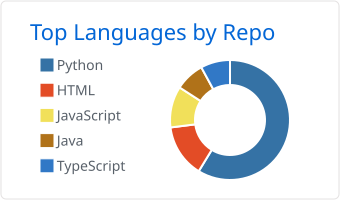
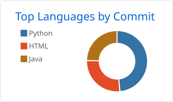
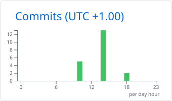

# Marvin Schubert

[Deutsch](./README.md) · **English**

### Python & Backend Developer

**Data pipelines · Automation · Web applications** 
Germany · B.Sc. Computer Visualistics and Design

[Projects](#projects) · [Experience](#experience) · [Tech Stack](#tech-stack)

---

## 👨‍💻 About Me

I build **Python backends, data pipelines and automation tools**. During more than **1.5 years as a working student at OTTO**, I developed monitoring dashboards, API-based systems and internal tools for e-commerce.

Since early 2025, I have also worked as a **freelance web developer**, building websites and web applications for small businesses. I combine backend development with user interface design and run my web projects on my own **Ubuntu server with Docker and NGINX**.

I completed my **B.Sc. in Computer Visualistics and Design** at Hamm-Lippstadt University of Applied Sciences in October 2025 (**bachelor’s thesis grade: 1.7**).

## 🚀 Selected Projects

### ApplyOrbit – Job Application Management

[**View live → applyorbit.de**](https://applyorbit.de)

A web application that brings job applications, appointments, contacts and next steps together in one place. User accounts with JWT authentication, tags and a dashboard help users organize their job search.

**Implementation:** FastAPI backend with SQLAlchemy and a responsive frontend built with SvelteKit, TypeScript and Tailwind CSS.

### Fortuna’s Blumenboulevard – Website & Workshop Booking

[**View live → fortunas-blumenboulevard.de**](https://fortunas-blumenboulevard.de)

A website for floristry and workshops in Hanover and Hamburg. The booking system connects workshop registration with **Stripe Checkout, PDF invoices and an admin panel**. A gallery and email integration complete the site.

**Implementation:** Python backend with FastAPI and SQLAlchemy, HTML/SCSS and JavaScript; deployment with Docker and NGINX.

### VanThunder – Web Agency & Content Management

[**View live → vanthunderweb.de**](https://vanthunderweb.de)

An agency website with an **admin panel, blog and TipTap editor** for managing content. AI-assisted content generation and 3D animations extend the application.

**Implementation:** SvelteKit and TypeScript frontend, FastAPI backend, JWT authentication and Three.js; hosted with Docker and NGINX.

### Public Python Code – Unreal Engine Performance Analysis

- [**UE Performance Analyzer**](https://github.com/vanthunder/ue-performance-analyzer) turns profiler CSV files into Excel reports with averages and p95 metrics.
- [**UE A/B Comparison**](https://github.com/vanthunder/ue-ab-comparison) adds scene comparisons and percentage differences between two variants.

**Stack:** Python · pandas · NumPy · openpyxl

## 🏢 Experience at OTTO

Examples from my work as a working student:

### Data Pipeline → Apache Kafka

Automated transfer of inventory data from OTTO’s backlog list to Apache Kafka for downstream systems – **several hundred records per week**.

**Stack:** Python · Apache Kafka · REST APIs

### EDI Monitoring Dashboard

A web-based dashboard that visualizes EDI metrics and interface status for business and IT teams.

**Stack:** Python · Flask · JavaScript

## 🛠️ Tech Stack

### Languages

### Backend & Data

### Frontend

### Deployment & Operations

Additional Technologies & Tools

- **Languages & Web:** Java · HTML5 · CSS3 · SCSS
- **APIs & Services:** REST · JWT · Stripe
- **Development & Cloud:** Vite · GitHub · GitLab CI · Jenkins · Azure
- **AI & Automation:** OpenAI · PyTorch
- **Design & Media:** Photoshop · Illustrator · After Effects · Premiere Pro · Unreal Engine

## 🔭 Currently

- **Projects:** Freelance web projects and new client websites
- **Learning:** Kubernetes and cloud architecture
- **Contact:** [marvin.schubert@vanthunder.de](mailto:marvin.schubert@vanthunder.de)

---

## 📊 GitHub Activity

<picture>
  <source media="(prefers-color-scheme: dark)" srcset="./assets/github-trophies-dark.svg" />
  
</picture>

Show Statistics & Contribution Animation

<picture>
  <source media="(prefers-color-scheme: dark)" srcset="./profile-summary-card-output/github_dark/1-repos-per-language.svg" />
  
</picture>
<picture>
  <source media="(prefers-color-scheme: dark)" srcset="./profile-summary-card-output/github_dark/2-most-commit-language.svg" />
  
</picture>

<picture>
  <source media="(prefers-color-scheme: dark)" srcset="./profile-summary-card-output/github_dark/4-productive-time.svg" />
  
</picture>

<picture>
  <source media="(prefers-color-scheme: dark)" srcset="https://raw.githubusercontent.com/vanthunder/vanthunder/output/github-contribution-grid-snake-dark.svg" />
  
</picture>

Built with ❤️ in Germany

